# BRUMS — clarified Entity Relationship Diagram

## Core rule: one login identity, three non-overlapping roles

`users` is the shared **authentication identity**, with `role` restricted to **admin**, **staff**, or **client**. Its role-specific data belongs in `admins`, `staff`, or `clients`. **There are not three separate login tables**; that would make session management and foreign keys ambiguous. A user has one role at a time. Admins manage the system; staff belong to one branch and have a timetable; clients can select a preferred branch and create appointments.

```mermaid
erDiagram
    USERS ||--o| ADMINS : "admin role"
    USERS ||--o| STAFF : "staff role"
    USERS ||--o| CLIENTS : "client role"
    BRANCHES ||--o{ STAFF : "employs"
    BRANCHES ||--o{ CLIENTS : "preferred branch (optional)"
    USERS ||--o{ APPOINTMENTS : "client_id"
    BRANCHES ||--o{ APPOINTMENTS : "hosts"
    STAFF |o--o{ APPOINTMENTS : "assigned barber (optional)"
    STAFF |o--o{ APPOINTMENTS : "requested barber (optional)"
    SERVICES ||--o{ APPOINTMENT_SERVICES : "included service"
    APPOINTMENTS ||--|{ APPOINTMENT_SERVICES : "selected services"
    BRANCHES ||--o{ BRANCH_SERVICES : "offers"
    SERVICES ||--o{ BRANCH_SERVICES : "available at"
    BRANCHES ||--o{ INVENTORY : "stores"
    SERVICES ||--o{ SERVICE_INVENTORY : "requires"
    INVENTORY ||--o{ SERVICE_INVENTORY : "material used"
    STAFF ||--o{ STAFF_AVAILABILITY : "weekly timetable"
    STAFF ||--o{ STAFF_SERVICES : "qualified to perform"
    SERVICES ||--o{ STAFF_SERVICES : "certified craft"
    APPOINTMENTS ||--o| APPOINTMENT_VISITS : "actual attendance"
    USERS |o--o{ APPOINTMENT_VISITS : "checks in / checks out"
    APPOINTMENTS ||--o{ BOOKING_HISTORY : "lifecycle"
    APPOINTMENTS |o--o{ FINANCE : "checkout (optional)"
    BRANCHES ||--o{ FINANCE : "sales at"
    USERS |o--o{ FINANCE : "staff_user_id credited with sale"
    USERS ||--o{ API_SESSIONS : "authenticated sessions"
    USERS |o--o{ AUDIT_LOG : "actor (optional)"
    USERS |o--o{ VISITOR_LOG : "signed-in visit (optional)"

    USERS {
        int user_id PK
        string username UK
        string email UK
        string password_hash
        enum role "admin|staff|client"
        string name
    }
    ADMINS { int user_id "PK FK users.user_id" }
    CLIENTS { int user_id "PK FK users.user_id" 
              int preferred_branch_id FK }
    STAFF { int staff_id PK
            int user_id "FK UK users.user_id"
            int branch_id FK
            boolean is_active }
    BRANCHES { int branch_id PK
               string name }
    SERVICES { int service_id PK
               decimal price
               int duration_minutes }
    BRANCH_SERVICES { int branch_id "PK FK"
                      int service_id "PK FK"
                      boolean is_active }
    APPOINTMENTS { int appointment_id PK
                   int client_id "FK users.user_id"
                   int branch_id FK
                   int service_id "legacy primary FK"
                   int staff_id "nullable FK staff.staff_id"
                   int requested_staff_id "nullable FK staff.staff_id"
                   date appointment_date
                   time appointment_time
                   string status }
    APPOINTMENT_SERVICES { int appointment_id "PK FK"
                           int service_id "PK FK"
                           int quantity }
    INVENTORY { int inventory_id PK
                int branch_id FK
                int quantity }
    SERVICE_INVENTORY { int service_id "PK FK"
                        int inventory_id "PK FK"
                        decimal quantity_used }
    STAFF_SERVICES { int staff_id "PK FK staff.staff_id"
                     int service_id "PK FK services.service_id" }
    APPOINTMENT_VISITS { int appointment_id "PK FK appointments.appointment_id"
                         datetime checked_in_at
                         datetime checked_out_at
                         int checked_in_by "nullable FK users.user_id"
                         int checked_out_by "nullable FK users.user_id" }
    STAFF_AVAILABILITY { int availability_id PK
                         int staff_id FK
                         int weekday
                         time start_time
                         time end_time }
    BOOKING_HISTORY { int history_id PK
                      int appointment_id FK
                      int changed_by "FK users.user_id nullable" }
    FINANCE { int transaction_id PK
              int appointment_id "nullable FK"
              int branch_id "nullable FK"
              int staff_user_id "nullable FK users.user_id"
              decimal amount }
    API_SESSIONS { string session_id PK
                   int user_id FK
                   string token_hash
                   datetime last_seen_at }
    AUDIT_LOG { int audit_id PK
                int actor_user_id "nullable FK"
                string event }
    VISITOR_LOG { int visit_id PK
                  int user_id "nullable FK"
                  string ip_hash }
```

## Unambiguous relationship map

| Requested connection | Implemented foreign-key path | Cardinality |
|---|---|---|
| **Users → Services** | `users (client) → appointments.client_id → appointment_services → services` | Client 1-to-many bookings; booking many-to-many services |
| **Services → Branches** | `services → branch_services → branches` | Many-to-many, with `is_active` availability flag |
| **Services → Appointments** | `services → appointment_services → appointments` | Many-to-many, with `quantity` for repeated selections |
| **Users → Branch** | `users → staff.branch_id → branches` for staff; `users → clients.preferred_branch_id → branches` for clients; actual booking branch is `appointments.branch_id` | Staff: 1 current branch; client: 0–1 preference; bookings: 1 branch |
| **Services → Inventory** | `services → service_inventory → inventory` | Many-to-many, with units/quantity used |
| **Barber → Service specialization** | `staff → staff_services → services` | Many-to-many, explicitly administered capabilities (not free-text guesses) |
| **Appointment → In-person visit** | `appointments → appointment_visits` | One-to-zero-or-one; check-in and check-out audited |
| **Staff → Schedule** | `staff → staff_availability`, then `appointments.staff_id` for assigned times | One-to-many shifts and assignments |
| **Finance → Staff** | `finance.staff_user_id → users.user_id` (seller) | Distinct from `appointments.staff_id → staff.staff_id` (barber) |

### Business rules and data behavior

- Staff qualification records in `staff_services` must be set explicitly by an admin. Existing production staff do not automatically receive broad qualifications; the clean demo dataset includes examples.
- A booking **without a preferred barber** has a `NULL` `appointments.staff_id`. An **admin** assigns an active barber from the same branch through the daily timetable. Assignments reject overlapping bookings and shifts that do not cover the appointment (when shifts are published).
- A service can exist at several branches. A product/inventory row is stored at one branch; service-to-inventory links document resource usage. **Automatic inventory deduction per service is not implemented**; current stock is reduced only for products actually sold at POS.
- `appointments.service_id` and `appointments.service_ids` are legacy compatibility fields. New totals and staff overlap calculations use normalized `appointment_services` (with `quantity`). Run `npm run migrate:services` once after upgrading an existing database to restore all legacy selections, then it is safe to repeat.
- Changing role deactivates old staff membership when leaving staff, updates role-specific rows, and immediately revokes all existing sessions. Historical appointments keep their staff references.
- Rejected appointments are terminal and release the barber’s slot. Only admins can reject, with a reason in `booking_history` and an `audit_log` event. The appointment is still visible to the customer with status **Rejected**.
- In-person visits are recorded by `appointment_visits` after confirmation; `visitor_log` is a separate, pseudonymous website page-view dataset.
- `audit_log`, `visitor_log`, and `api_sessions` store pseudonymous metadata, not raw IPs or plaintext tokens. `login_attempts` is keyed by normalized login identifier and stores time-limited lockouts; it is not a user-profile table.
- The `database_dump.sql` script **deletes and recreates tables**; use it only for a fresh database, never as an upgrade script. Existing databases migrate through `ensureSchema()` and the service backfill command after a backup.

## v1.2.3 preference requests

`appointments.requested_staff_id` is an optional FK to `staff.staff_id`, recording the client's preferred barber. `appointments.staff_id` remains the actual assigned barber FK. When no qualification mapping exists, the client may request a barber but `staff_id` stays **NULL** until an admin approves competencies and assignment. Booked time slots for a requested barber remain blocked; an unassigned request itself does not reserve the barber.
